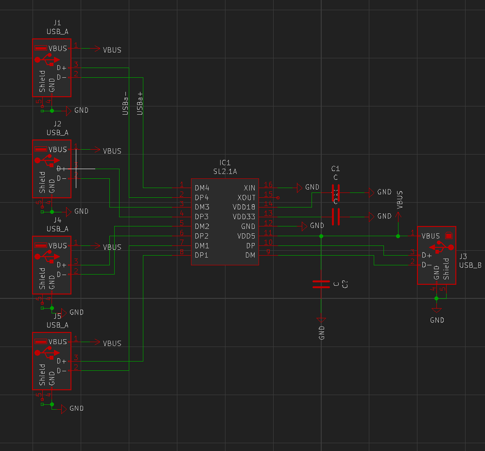
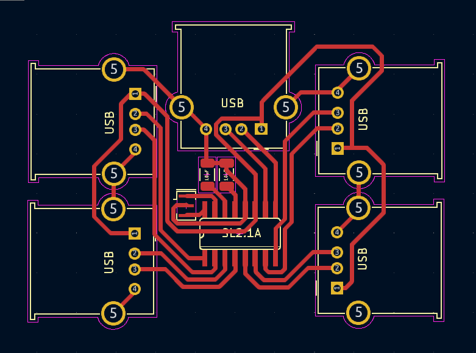

# SL2.1A_USBHUB ✅ Completed

## Description:
This is an USB HUB using the SL2.1A ic. Because it is so easy to do, I did not order the board.I wanted an ic with some interrupt or controll functions to connect it to a microcontroller so I looked after another IC([FE1.1S_USBHUB](https://github.com/Tonikiller10000/FE1.1S_USBHUB)).
You can fing another similar schematic in the IC [datasheet](https://cdn-shop.adafruit.com/product-files/2991/1811151645_CoreChips-SL2-1A_C192893.pdf).

## Pinout: 
- 8 data pins for the 4 downward ports;
- 2 data pins for the upward port;
- 2 pins for external cristal use (has internal cristal); 
- 2 pins + an 10uF capacitor each (for smoothing the internal voltage regulator output)
- 2 power pins from the upward port (smoothing voltage capacitors recomeded)

## License

This project and its subprojects are licensed under
the [MIT License](LICENSE).